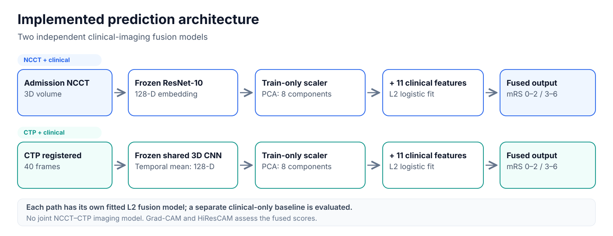
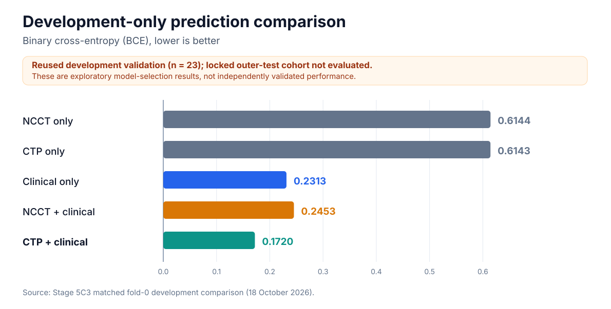
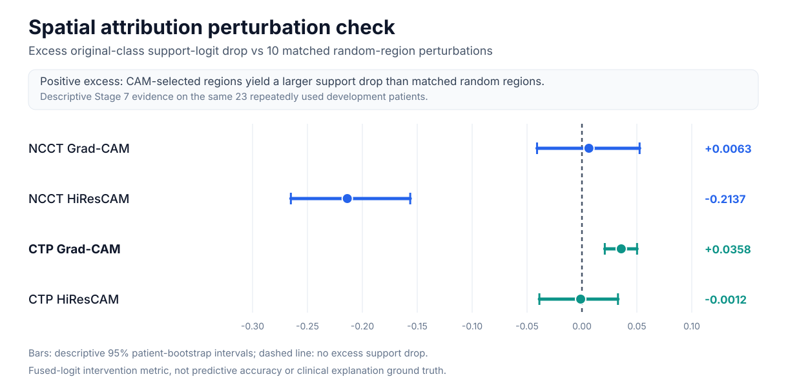

# ELE630 | Explainable Stroke Outcome Prediction

Research code for predicting 90-day functional outcome after ischemic stroke from admission CT imaging and clinical information, with an emphasis on **evaluating what the models actually use**.

> This repository accompanies an exploratory university study with a single internal held-out evaluation. The study provides no evidence of external validation or clinical deployment readiness.

**University of Stavanger (UiS) · ELE630 Research Project · Autumn 2026**
**Researchers:** Mahdi Nasser and Bashar S. F. Albittar

## Research question

Can CT-derived image information improve prediction beyond a small clinical baseline, and do explanation maps meaningfully identify relevant image regions?

The outcome is binary **90-day modified Rankin Scale (mRS)**: 0–2 versus 3–6. The curated study includes 150 imaging patients, of whom 143 have valid outcome labels. The original fold-0 analysis used **92 training**, **23 repeatedly examined development-validation**, and **28 independently held-out test** patients. All five predictors underwent a **single frozen internal test on 10 November 2026**. This is a small internal generalization check, not five-fold, external or prospective validation.

## Implemented modelling paths

| Path | Model and role |
| --- | --- |
| NCCT | `CompactResNet10`, a scratch-trained 3D residual network for an admission NCCT volume. Its frozen encoder provides 128 image features. |
| CTP | `CompactCTPMean(width=16)`, a shared 3D encoder applied to all 40 registered CTP frames; the mean 128-dimensional frame embedding represents the series. |
| Clinical reference | Fixed L2 logistic regression using 11 candidate admission-time clinical predictors with training-only preprocessing. |
| NCCT + clinical | The frozen NCCT embedding is standardized and reduced to eight PCA components using training patients only; these are concatenated with the 11 clinical features and fitted with a separate L2 logistic regression. |
| CTP + clinical | The same fusion recipe, using the independently trained and frozen CTP encoder. |

**Important:** NCCT + clinical and CTP + clinical are **two separate comparisons**. The project did not train a combined NCCT–CTP image-fusion network.

### Architecture at a glance

This schematic reflects the implemented prediction architecture (described in the separately submitted PDF report). Each image branch has its own frozen encoder and fitted fusion head; the 11-feature clinical-only reference is a separate model.

### Explainability and checks

- **Grad-CAM and HiResCAM:** spatial attribution for the frozen, clinically fused scores.
- **Anatomical localization:** attribution mass and volume-normalized enrichment in the available core, penumbra and other reference regions.
- **Perturbation faithfulness:** fixed-budget image interventions compared with matched random controls.
- **Sanity checks:** attribution sensitivity to selected model-parameter randomizations.
- **CTP temporal analysis:** frame-content sensitivity under five-frame-window perturbations; the temporal-mean encoder does not learn frame order.
- **Clinical-feature audit (separate controlled bundle):** exploratory permutation importance, leave-one-feature-out refitting, and leakage/provenance diagnostics on fresh patient-disjoint folds within the original 92 training patients. The audit runner itself is not part of this code repository; its aggregate findings are documented in the companion report.

The clinical baseline is strong on the small development cohort, but feature recording times are not fully verified. The project therefore **does not claim leakage-free clinical deployment, external validation, or causal explanations**.

## Results: development versus final internal test

The 23 development-validation patients were reused during model selection. The separate 28-patient internal test was run **once on 10 November 2026**, using fixed model recipes and a probability threshold of 0.5. These are different cohorts, not paired patient predictions.

| Prediction branch | Development AUROC (n=23) | Final test AUROC (n=28) | Test BCE ↓ | Test Brier ↓ |
| --- | ---: | ---: | ---: | ---: |
| NCCT only | 0.6161 | 0.2924 | 0.6291 | 0.2186 |
| CTP only | 0.6786 | 0.4444 | 0.6289 | 0.2185 |
| Clinical only | 0.9821 | **0.6199** | 0.6539 | 0.2184 |
| NCCT + clinical | 0.9732 | 0.5965 | 0.7435 | 0.2330 |
| CTP + clinical | 1.0000 | 0.6140 | 0.9222 | 0.2613 |

**Interpretation:** The apparent CTP-fusion development advantage did **not** generalize in this small internal test; neither imaging–clinical fusion branch demonstrated improvement over clinical-only. At threshold 0.5, both imaging-only models predicted favorable outcome for every test patient, detecting **0 of 9** unfavorable outcomes. A post-hoc analytical constant reference using the training prevalence (29/92) achieved **BCE 0.628031** and **Brier 0.218151** on test28; all five learned models had higher probability losses. The tiny test set does not establish the models' ranking in a wider population.

The clinical fields' source timestamps and revision histories have not all been verified. There is **no clinical deployment claim, externally validated performance, or demonstrated incremental imaging benefit**. Full numerical results, discussion and supplementary analyses appear in the separately submitted ELE630 PDF report.

## Selected aggregate-only figures

The first plot is **development-only** (n=23, repeatedly inspected), not final-test performance. The second plot is also **development-only** XAI evidence. Neither figure includes patient images or case-level outputs.

### Development-only prediction loss

The CTP + clinical branch had development BCE 0.1720 versus clinical-only BCE 0.2313, but its final held-out BCE was 0.9222 versus clinical-only 0.6539. The development AUROC of 1.0000 was not confirmed independently.

### Explainability: spatial perturbation faithfulness

**Interpretation:** On the reused development set, CTP Grad-CAM-selected regions produced a larger average original-class support-logit drop than matched random selections; NCCT HiResCAM produced a negative excess under this specific blur intervention. Bars are **descriptive patient-bootstrap 95% intervals**, not proof of a clinically correct explanation or independent predictive performance. See the separately submitted ELE630 PDF for the full quantitative XAI results.

These vector illustrations were redrawn from **reported aggregate measurements**. They contain no patient-level images, identifiers, clinical rows, or case-level predictions. The manuscript’s processed CAM illustrations are governed separately from this code release.

## Repository guide

### Core implementation files

Start here to inspect the actual model architectures and explanation algorithms used in the study, rather than only their experiment scripts or protocol documentation.

| Component | Source code | What to look for |
| --- | --- | --- |
| **NCCT model** | [`resnet3d.py`](src/ele630/resnet3d.py) | `CompactResNet10` and `BasicBlock3D`: compact 3D residual CNN, GroupNorm, global pooling and 128-dimensional embedding. |
| NCCT training and configuration | [`ncct_training.py`](src/ele630/ncct_training.py), [`ncct_model_config.py`](src/ele630/ncct_model_config.py) | Fold-level training, architecture identity and geometry configuration. |
| **CTP model** | [`ctp_model.py`](src/ele630/ctp_model.py) | `CompactCTPMean`: shared 3D encoder, temporal mean pooling and memory-bounded frame recomputation. Also contains the exploratory mean-plus-standard-deviation and shallow-TCN alternatives. |
| CTP training | [`ctp_training.py`](src/ele630/ctp_training.py) | Fold-0 training and validation of the CTP models. |
| Clinical–image fusion | [`fusion.py`](src/ele630/fusion.py) | Training-only image PCA and fixed logistic-regression fusion. |
| **Grad-CAM and HiResCAM** | [`xai_spatial.py`](src/ele630/xai_spatial.py) | `cam_definitions`, `ncct_cam` and `ctp_cam`: both 3D CAM algorithms and modality-specific attribution. |
| XAI prediction target | [`xai_fused_score.py`](src/ele630/xai_fused_score.py) | Differentiable fused logit, predicted-class sign and image gradients. |
| XAI spatial evaluation | [`xai_perturbation.py`](src/ele630/xai_perturbation.py), [`xai_metrics.py`](src/ele630/xai_metrics.py), [`xai_geometry.py`](src/ele630/xai_geometry.py) | Matched random controls, blur interventions, anatomical enrichment, nuisance attribution and native-grid projection. |
| XAI sanity and temporal checks | [`xai_randomization.py`](src/ele630/xai_randomization.py), [`xai_temporal.py`](src/ele630/xai_temporal.py) | Parameter randomization and five-frame CTP content occlusion. |
| XAI analysis and execution | [`xai_analysis.py`](src/ele630/xai_analysis.py), [`xai_runner.py`](src/ele630/xai_runner.py), [`run_stage7_xai.py`](scripts/experiments/run_stage7_xai.py) | Per-case quantitative analysis, guarded orchestration and command-line entry point. |

## Run the synthetic examples

The tested environment is Linux x86-64 with Python 3.11. The smoke example
uses fabricated arrays, randomly initialized networks, and fabricated clinical
rows. It runs on CPU without loading checkpoints or opening any data directory.

~~~bash
python3.11 -m venv .venv
. .venv/bin/activate
python -m pip install -r requirements-cpu.txt
python -m pip install --index-url https://download.pytorch.org/whl/cpu 'torch==2.15.0+cpu'
python scripts/synthetic_smoke.py
~~~

Run the unit and synthetic regression tests in the same environment.

~~~bash
OMP_NUM_THREADS=1 MKL_NUM_THREADS=1 OPENBLAS_NUM_THREADS=1 \
  python -m unittest discover -s tests -v
~~~

[Installation and input configuration](docs/README.md) documents the CPU setup,
the input names and the reproducibility boundaries.

## Study provenance and report coverage

The predictive test compared the five predefined branches on the same 28
internal held-out cases. The work used the 92 training cases to reconstruct
unavailable fitted clinical and fusion estimators. Numerical checks against
historical development evidence preceded the sealed evaluation. The recorded
sealed frozen-run SHA-256 starts with **add24a72**. This identifies the frozen
run bundle. The protocol document has a separate hash.

| Reported component | Source available in this snapshot | Study population |
| --- | --- | --- |
| Matched image and clinical model comparisons | [Model and fusion code](src/ele630/) and [fusion protocol](docs/stage5c3_clinical_imaging_fusion_protocol.md) | Train 92 / development 23 |
| Quantitative spatial and temporal XAI | [Analysis](src/ele630/xai_analysis.py), [metrics](src/ele630/xai_metrics.py), [Stage 7 protocol](docs/stage7_xai_protocol.md) | Development 23 |
| Frozen internal predictive evaluation | [Evaluation logic](src/ele630/heldout.py), [runner](src/ele630/heldout_runner.py), [protocol](docs/final_heldout_protocol.md) | Held-out 28 |
| Exploratory clinical-feature OOF audit | Aggregate results and methods in the manuscript. Exact standalone driver retained separately. | Train 92 |
| Exploratory NCCT geometry, pooling and negative controls | Aggregate results and methods in the manuscript. Exact standalone drivers retained separately. | Train 92 |
| Auxiliary mask occupancy and NCCT input intensity audits | Aggregate results and methods in the manuscript. The executed audit drivers and records are retained separately. | Development 23 |

See [study provenance](docs/README.md#study-provenance) for a short mapping to the
historical research revisions. Real-data replay requires the original authorized
research archive and its original source, input, environment and artifact
bindings. The environment specified above supports the repository’s synthetic
example and tests.

## Code availability and license

The public snapshot includes the project-authored implementation, aggregate
figures and synthetic tests. The clinical dataset, patient-level outputs,
trained checkpoints and original private research history are not publicly
available. Their access is governed separately from the code license.

The project code is available under the [MIT License](LICENSE). Independently
installed third-party dependencies retain their own licenses. See the
[contribution and data handling guide](CONTRIBUTING.md) for repository practices.
